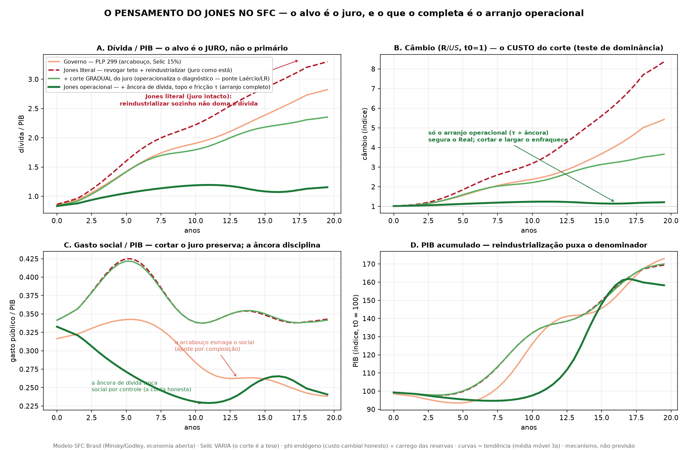

# Diálogo com Jones Manoel: por que o governo não enfrenta o mercado

**Objeto.** A leitura de **Jones Manoel** sobre por que um governo popular não enfrenta o
mercado financeiro — e o que o nosso modelo diz quando se tenta enfrentar. Como nas outras
peças, a posição dele é apresentada na terceira pessoa, com caridade, e depois confrontada
com as contas. O ponto central é simétrico ao do Lara Resende: **sozinho, o Jones também
não se sustenta — foi só ao combinar os dois que o modelo fechou** (ver
[`a-virada-lr-mais-jones.md`](a-virada-lr-mais-jones.md)).

---

## 1. A pergunta

Lula, em Madri: *"Não posso ser refém do mercado, do sistema financeiro; tenho que ser
refém do povo brasileiro."* A pergunta inevitável: **por que, então, ele não enfrenta o
mercado?** Há apoio popular, há mandato. A resposta de Jones Manoel é mais dura — e mais
interessante — do que "falta coragem". Tem quatro camadas.

## 2. A resposta de Jones — quatro camadas

**(a) A armadilha institucional.** O governo teme o fim do teto de gastos porque não quer
enfrentar a pressão do mercado e da grande burguesia. O mecanismo é fino: **o teto criou a
captura.** Ao congelar o gasto, empurrou os deputados para a emenda obrigatória (de ~R$4 bi
no governo Temer para R$60+ bi hoje). *Enquanto existir austeridade, deputado nenhum abre
mão de emenda* — o Congresso fica preso ao arranjo que, por sua vez, prende o governo.

**(b) Por que o mercado QUER austeridade — Kalecki (1943).** Aqui está o núcleo. Jones cita
*"Aspectos Políticos do Pleno Emprego"*, de Michał Kalecki. A austeridade serve a três
funções, nenhuma delas a anunciada:
1. **Abrir espaço de acumulação ao capital privado** — sucatear SUS, escola e segurança
   pública faz crescer o plano de saúde, a clínica, a educação e a segurança *privadas*.
2. **Disciplinar a classe trabalhadora** — austeridade → baixo crescimento → desemprego e
   informalidade altos → *o medo da demissão* trava greve e mobilização. **A austeridade
   desmobiliza de propósito a força que enfrentaria o mercado.**
3. **Congelar o país na divisão internacional do trabalho** — num capitalismo dependente,
   não há reindustrialização sem Estado investindo. (É o lastro teórico do investimento
   público da nossa proposta.)

**(c) O mercado derruba governo popular.** A arma não é o tanque: é a inflação importada
(câmbio, combustível, alimentos) que a extrema-direita converte em voto. O credor precisa
de câmbio e de um microfone.

**(d) O caráter de classe do Estado — Perry Anderson.** No fundo: a burguesia pôde ser
classe economicamente dominante *antes* de tomar o poder político; a classe trabalhadora
não pode. Quem controla mídia, economia e aparato é o outro lado. Conclusão de Jones: **um
governo popular dentro do capitalismo joga em campo adversário** — daí ele puxar para a
ruptura.

## 3. O ponto cego — e onde o nosso modelo entra

O próprio campo marxista declara o limite da escola: *"o que a escola não consegue dizer é
o que fazer com a trajetória da dívida. 'Baixar os juros' é a resposta, mas a escola não
tem teoria operacional de como fazê-lo numa economia aberta sem os efeitos que a ortodoxia
prevê."*

É **exatamente esse buraco** que o nosso modelo stock-flow consistent preenche. Rode
[`../modelos/bateria_jones.py`](../modelos/bateria_jones.py): ele põe o pensamento de Jones
para rodar na economia aberta, com o custo cambial do corte aparecendo honestamente.

> **Nota de atribuição (para não falsear ninguém).** Jones **diagnostica** o juro como a
> disfunção central e critica a "austeridade monetária violenta". Mas o **remédio** que ele
> propõe é **estrutural** — revogar o teto, reindustrializar, superar o neoliberalismo; ele
> **não** oferece o corte *operacional* da Selic (é o ponto cego). Sobre o Lara Resende,
> *elogia o diagnóstico e recusa a terapia* (o tabelamento). O **corte gradual do juro** —
> em degraus, não o salto único — é a ponte que o autor deste repositório construiu a partir
> do diagnóstico que Jones e LR compartilham.

| cenário | Selic | dívida/PIB | câmbio | G/Y |
|---|---|---|---|---|
| Governo — PLP 299 (arcabouço) | 15% | 2,92 | 5,91 | 0,24 |
| **Jones literal** — revogar teto + reindustrializar (juro como está) | 15% | **3,40** | **9,16** | 0,35 |
| + corte **gradual** do juro (ponte Laércio/LR) | 10% | 2,41 | 3,84 | 0,35 |
| **Jones operacional** — + âncora de dívida, topo, fricção | 10% | **1,18** | **1,23** | 0,23 |

*(Modelo SFC Brasil, Minsky/Godley, 20 anos; mecanismo, não previsão.)*

Três leituras, todas honestas:

1. **O diagnóstico de Jones se sustenta — justamente porque o "Jones literal" é o pior de
   todos.** Revogar o teto e reindustrializar *sem tocar operacionalmente no juro* dá o pior
   resultado (dívida 3,40, câmbio 9,16): sem âncora a dívida corre; com a Selic alta o
   câmbio dispara. O próprio modelo mostra por que o juro é a alavanca que decide tudo — o
   que Jones diagnostica mas deixa sobre a mesa. O primário não é o problema; o juro é.
2. **Operacionalizar o corte (a ponte LR) vira o jogo.** O corte gradual derruba a dívida
   (3,40 → 2,41) e o câmbio (9,16 → 3,84) e passa a bater o governo em tudo, preservando o
   social. É o degrau que falta no Jones literal.
3. **Mas cortar e largar ainda não fecha; o arranjo operacional fecha.** Só **âncora de
   dívida + cobrança do topo + fricção cambial** controla os dois (dívida 1,18, câmbio
   1,23). O modelo fornece a "teoria operacional" que a escola marxista reconhece não ter.

## 4. A conta honesta (não repetir o erro do adversário)

O arranjo operacional **tem um custo**, e escondê-lo seria desonesto: a âncora de dívida
disciplina o gasto (no modelo, G/Y cai e a parcela salarial aperta). **A âncora troca
social por controle da dívida.** Quem mais preserva o social no curto prazo é justamente o
"Jones revogar e largar" — que é o que não controla o câmbio. Não há almoço grátis: a
escolha é entre *mais social com mais risco cambial* e *menos risco com mais disciplina*. O
honesto é mostrar os dois e deixar a escolha política explícita.

## 5. A dobra

O diagnóstico é compartilhado; **a saída diverge**, e é aí que mora a força:

- **Jones:** o governo não enfrenta porque, dentro do capitalismo, **estruturalmente não tem
  como** — a saída real é romper o modelo.
- **A posição deste repositório:** o governo não enfrenta porque **escolheu** a âncora
  errada e entregou um ajuste pré-cozido ao mercado (começou pelo piso, invertendo a
  negociação). E há uma saída **dentro da institucionalidade** — a escada — que ataca o
  credor sem precisar de ruptura, desde que venha com o arranjo operacional que segura o
  contra-ataque cambial.

O modelo não refuta Jones: **completa-o.** Dá ao "baixar os juros" a engenharia de como
fazê-lo em economia aberta — e, no caminho, mostra que o governo *poderia* enfrentar o
mercado sem romper nada, bastando a coragem política que a fala de Madri promete.

---
*Para interrogar você mesmo: rode [`../modelos/bateria_jones.py`](../modelos/bateria_jones.py)
e a jornada em [`../modelos/jornada/`](../modelos/jornada/). Veja também
[`a-virada-lr-mais-jones.md`](a-virada-lr-mais-jones.md) e
[`dialogo-lara-resende.md`](dialogo-lara-resende.md).*
