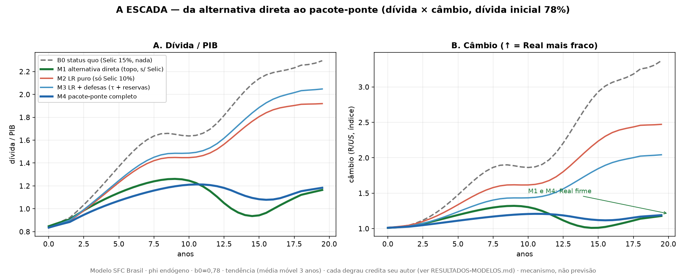

# O Juro Invisível

### Por que o ajuste fiscal brasileiro mira no alvo errado — e por onde uma saída honesta começaria

> *Rascunho — voz do Laércio, registro de ensaio público (estilo Lara Resende). Escrito no Tom 1
> (ensaio sóbrio: abre no fato, nomeia a coisa, afirma sem rodeios). Onde o conceito aperta, entra uma
> cena curta no Tom 3 — a imagem concreta que destrava a leitura, não o lead. Este é o relatório
> legível; o lastro técnico (as equações, o modelo, as fontes) está no Estudo de Impacto do Ajuste
> Fiscal Brasileiro.*

---

Há uma despesa no orçamento brasileiro maior que a saúde e a educação somadas, e que quase ninguém
nomeia. Em 2025, o Estado pagou da ordem de **1,2 trilhão de reais apenas de juros** sobre a própria
dívida. Não é gasto com o povo: é uma transferência — do conjunto da sociedade para os poucos que
detêm os títulos. É a maior despesa do país. E enquanto se discute, com ar de seriedade, cortar o piso
da saúde, essa rubrica segue tratada como se fosse um fato da natureza: intocável, invisível, fora de
cogitação. Não é.

Convém dizer a tese sem rodeios: **o rombo das contas públicas é o juro, não o gasto.** Não é uma
palavra de ordem. É o diagnóstico de André Lara Resende em seu *Eu Acuso*, e é o que boa parte da
esquerda — de Jones Manoel a Lindbergh — vem dizendo, cada um à sua maneira. O que faltava a esse
diagnóstico disperso era uma coisa só: um modelo que o tornasse visível, número a número, e que
mostrasse não apenas que o alvo está errado, mas **por onde uma saída honesta começaria**. É o que
este relatório apresenta.

## O diagnóstico: por que a austeridade erra o alvo

A dívida de um país, medida como proporção do que ele produz, sobe ou desce por três forças, e só
três: o **juro** que ela paga, o **crescimento** da economia e o **resultado primário** — a diferença
entre o que o governo arrecada e o que gasta fora os juros. A relação entre as duas primeiras decide
tudo. Quando o juro é maior que o crescimento, a dívida deixa de ser um estoque estável: passa a rolar
sobre si mesma e a crescer sozinha, sem que o governo gaste um único centavo a mais.

Vale tornar isso concreto. Imagine uma família que, todo mês, vê um terço do salário desaparecer antes
mesmo de comprar comida. Não é que ela gaste demais com supérfluos: caiu no rotativo do cheque
especial, e os juros passaram a crescer sozinhos, comendo o orçamento por dentro. Cada mês ela paga uma
fortuna de juros, cada mês deve mais, e sobra menos para tudo. E a receita que lhe dão é sempre a mesma
— cortar na feira, tirar o filho do curso, apertar o cinto —, nunca mexer no juro, que é de onde o
buraco de fato vem. O Estado brasileiro está na mesma armadilha, apenas em escala de trilhão.

É aqui que a austeridade erra. Ela mexe em uma só dessas forças, e pela pior ponta: corta o gasto para
melhorar o primário. Só que cortar gasto **derruba o crescimento** — menos investimento público, menos
demanda, economia mais fraca. E então vem o efeito perverso: com a economia encolhendo, a dívida *como
proporção do PIB* pode até **subir**, apesar do corte. Aperta-se o cinto, e o número piora. É mirar no
alvo errado e, ainda por cima, errar a pontaria.

Dos três termos, o maior, no Brasil, é disparado o juro — porque a dívida é grande e, sobretudo, porque
quase metade dela está atrelada diretamente à Selic. Quando o Banco Central sobe a taxa, a conta de
juros sobe no mesmo trimestre. É um fio direto, automático, do juro para o déficit. Lara Resende tem
uma expressão exata para isso: a Selic alta é uma **"bolsa-rentista"** — uma transferência contínua de
renda, de baixo para cima, de quem trabalha e paga imposto para quem possui os títulos da dívida.

Vale nomear o que é esse título. Quando o Estado se endivida, o que o credor compra não é uma fábrica,
uma estrada, nada que produza: é um **papel que lhe dá direito a um fluxo de juros**, pago com o
imposto de todos. Marx chamava isso de "capital fictício" — rende como se fosse capital, mas não há
capital real por trás, só o direito legal ao fluxo. Guarde essa imagem: ela volta no fim.

## O limite honesto — e a pergunta que decide tudo

Aqui é preciso ser justo com a crítica mais séria à proposta de Lara Resende. Cortar a Selic, dizem,
pode afundar o Real: o investidor estrangeiro, sem o juro gordo, tira o dinheiro do país, o dólar
dispara, a inflação volta pela porta dos importados. É uma objeção legítima. E a resposta honesta não
é ignorá-la — é mostrar **quando** ela vale e quando ela se inverte.

Pense na Selic como um antibiótico contra a inflação. No paciente comum, o antibiótico cura: juro mais
alto atrai capital, segura o câmbio, esfria a demanda. Mas existe um ponto em que o paciente fica
**alérgico** — e a mesma dose passa a piorar a doença. Esse ponto tem nome: **dominância fiscal**.
Quando a dívida é grande demais e colada demais à Selic, subir o juro não acalma o mercado: ao
contrário, faz a conta da dívida explodir, o mercado enxerga a bola de neve, o risco do país sobe, e o
capital foge — derrubando o Real justamente pela arma que deveria defendê-lo. Nesse regime, o remédio
virou veneno.

Essa inversão não é retórica. Ela sai de um modelo. Montamos uma representação da economia brasileira
que respeita a contabilidade (cada real que sai de um lugar entra em outro) e deixamos o prêmio de
risco reagir à saúde da dívida. O resultado é a figura abaixo: **a mesma Selic tem efeito oposto no
câmbio conforme o regime.**

A leitura é poderosa, e ela reorganiza todo o debate. Se o Brasil está em dominância, Lara Resende tem
razão: cortar a Selic ajuda o câmbio, não o contrário. Se não está, a ortodoxia tem razão. Toda a
briga, portanto, desaba sobre **uma única pergunta empírica: o Brasil já cruzou esse limiar?**

O modelo não responde a essa pergunta — ele mostra o mecanismo, não crava o diagnóstico. Quem responde
são os sintomas, e eles não são poucos: 74% da dívida é indexada (à Selic e à inflação), o que impede
o Estado de "inflar a dívida para fora"; há mais de um trilhão em operações compromissadas — dívida
que paga Selic sem aparecer como dívida; o juro real supera o crescimento ano após ano. São os sinais
clínicos de uma economia que, no mínimo, flerta com a dominância e escorrega para dentro dela nos
momentos de estresse.

E aqui está a parte elegante da proposta, a que a desarma da acusação de aventura: **o corte gradual
da Selic é, ele mesmo, o teste.** Corte dois pontos. Se o Real apreciar — ou ao menos segurar —, o
diagnóstico estava certo, e segue-se cortando. Se o dólar disparar, erramos, e para-se. Não é uma
aposta cega; é o método científico aplicado à política monetária, com as reservas comprando o tempo do
experimento.

Há ainda um segundo motivo para cortar, independente de todo esse debate, e contraintuitivo. O país
guarda hoje cerca de 358 bilhões de dólares em reservas para defender o Real. Só que **carregar essas
reservas custa caro quando a Selic está alta** — paga-se a Selic para captar o que rende bem menos lá
fora. Essa conta escondida, o "carrego", é uma sangria quase-fiscal que cresce com a Selic. Cortar o
juro não só alivia a dívida: **alivia também o custo de guardar as reservas.** A Selic alta é cara dos
dois lados.

## A escada: por onde começar de verdade

Até aqui, o debate ficou preso entre a ortodoxia ("não cortem a Selic") e Lara Resende ("cortem a
Selic"). Mas essa é uma falsa escolha, e o modelo mostra por quê. A saída não é *um* botão — é uma
**escada**, com uma ordem de combate.

O **primeiro degrau não é a Selic.** É a alternativa direta, e ela recusa a própria premissa do ajuste:
não é preciso cortar o povo para equilibrar as contas — basta **cobrar de quem tem e de quem deve**.
Taxar os super-ricos e os dividendos hoje isentos, acabar com as renúncias fiscais do topo, e cobrar
dívidas que a banca pública deixou de cobrar. É o que o deputado Lindbergh Farias (PT) e a deputada Fernanda Melchionna
(PSOL) vêm propondo, e é o que Rachel Sherazade traduziu bem para o popular: *"aceito o ajuste,
desde que o corte comece no andar de cima."*

Quando se liga essa alavanca no modelo, o resultado surpreende: **ela controla a trajetória da dívida e
firma o câmbio, sem cortar o povo e sem nem tocar na Selic.** A figura abaixo põe a escada inteira lado a lado. O pior cenário de
todos é o de não fazer nada (manter a Selic alta): em dominância, ele afunda a dívida *e* o Real ao
mesmo tempo. A alternativa direta resolve os dois — e empata, no resultado, com o pacote mais completo.

Só se o primeiro degrau não passar — e aqui entra o alerta de realpolitik que Lindbergh e Melchionna
fazem, de que *o Congresso tira a taxação do rico e mantém o corte no povo* — é que se **desce para o
segundo degrau**: a negociação. Aí sim entra o pacote de Lara Resende, o corte da Selic, acompanhado
das defesas do câmbio — formar reservas (inclusive em ouro), desindexar a dívida, e pôr um grão de
areia no mercado de câmbio, uma fricção sobre os fluxos especulativos, como propõe José Kobori. A
compensação é o plano B da negociação, não o ponto de partida.

E há um achado que costura tudo, talvez o mais importante deste trabalho. Cortar a Selic numa economia
frágil, não-ancorada, de fato pressiona o câmbio — é o limite honesto da proposta pura. Mas cortá-la
*depois* de ter ancorado a dívida pela alternativa direta é seguro. Ou seja: **a alternativa direta
não é uma alternativa ao corte da Selic — é a precondição que o torna seguro.** Ancora-se primeiro,
corta-se depois. Nisto, a esquerda e Lara Resende não se opõem: eles se ordenam.

## O teto e o arcabouço: o que escondem

Nada disso respira, porém, enquanto a política fiscal estiver trancada dentro das duas regras que a
amarram: o antigo teto de gastos e o arcabouço fiscal que o sucedeu. A tese do campo — de Jones Manoel
a Kobori — é direta: revogar ambos. A pergunta honesta é: isso se sustenta?

O modelo responde com uma correção que fortalece a tese em vez de enfraquecê-la. **Revogar e largar não
funciona:** sem nenhuma âncora, a dívida de fato dispara — e aqui o espantalho da direita tem um ponto.
Mas **revogar e ancorar** é outra história. Se, no lugar do teto de gasto, a âncora passa a ser a
*trajetória da dívida* — uma regra que aperta o primário quando a dívida sobe e solta o gasto social
quando ela está sob controle —, o resultado é melhor que o do teto em tudo o que importa: controla a
dívida *melhor*, e ao mesmo tempo **preserva o gasto social**.

E o modelo expõe o que o teto esconde. Ele parece "funcionar" — controla a dívida, entrega até algum
crescimento. Mas quando se olha a parcela que vai para os salários, ela despenca: **o teto cresce
reprimindo salário.** Ele não precisa nem cortar nada no papel; basta deixar o gasto social encolher
como fatia do bolo, ano após ano, enquanto o bolo cresce. É um ajuste por atrito, silencioso, que
esvazia o Estado social sem um único corte nominal que se possa apontar.

É o tipo de coisa que não aparece num gráfico de manchete, mas aparece na vida. O salário do servidor
nunca é cortado no papel — só vai valendo um pouco menos a cada ano. A escola não fecha — só recebe,
por aluno, um pouco menos a cada orçamento. O posto de saúde continua de pé — com a fila crescendo no
ritmo em que o repasse encolhe. Ninguém assina a conta; e, no fim de uma década, o Estado social virou
sombra do que a Constituição prometeu.

O crescimento que o teto entrega, portanto, é crescimento de repressão. A disputa, no fim, nunca foi
crescer contra não-crescer. É **crescer para quem.**

## O caráter de classe: por que o ajuste se repete

Falta explicar por que, mesmo sob governos de esquerda, o ajuste sempre volta mirando os mesmos de
baixo. A resposta não está na má-fé de ninguém; está na estrutura. E há um exemplo que a mostra em
estado puro.

Enquanto se prepara o corte fiscal mirando saúde e educação, o Banco do Brasil — um banco público —
teve o lucro desabar 66% num único trimestre, por inadimplência do agronegócio. O grande produtor de
soja e pecuária do Centro-Oeste recusou-se a renegociar suas dívidas; o pequeno, o da agricultura
familiar, o do Pronaf, paga em dia — inadimplência de 2,95% contra 6,92% dos grandes. É a imagem
perfeita da hipocrisia: a "responsabilidade fiscal" que corta o piso social poupa religiosamente o
andar de cima. (Convém ser preciso: o calote de fato em atraso é da ordem de 28 bilhões, não os 100
bilhões que às vezes se cita — mas o escândalo defensável não é o número inflado, e sim o grande
devedor que não paga enquanto o pequeno paga, e o Estado que cobra do pequeno.)

Isto tem genealogia. Marx já mostrava que a dívida pública foi uma das maiores alavancas da acumulação
do capital, e que seu complemento necessário era um sistema tributário que recai sobre os mais pobres —
"a sobretaxação", escreveu ele, "não é um acidente, é um princípio". E Keynes — que não era
revolucionário — defendeu a "eutanásia do rentista", o investidor sem função, de forma gradual e "sem
revolução". Reduzir a renda do rentista, portanto, não é pauta de ruptura: tem paternidade
liberal-keynesiana. É o encontro, incomum, de Marx com Keynes, pela mão do próprio Lara Resende.

## A substância contra a forma

Fica uma última pergunta, e ela é a que mais importa. A Constituição de 1988 colocou a **dignidade da
pessoa humana** como o primeiro fundamento da República. Dignidade, no sentido forte da palavra — em
Kant, aquilo que *não tem preço*, que não pode ser trocado por um equivalente. É o oposto exato da
lógica que trata tudo, inclusive a saúde e a educação de um povo, como uma linha de ajuste a ser
cortada para fechar uma conta.

O que está em jogo no "ajuste fiscal", no fundo, é isto: um Estado que **mantém a forma** — a
Constituição, o discurso dos direitos, o teatro da responsabilidade — enquanto **esvazia a substância**.
Preserva-se o artigo primeiro, e corta-se o que ele deveria garantir. Não por maldade de quem assina;
por estrutura de quem manda.

A esquerda tinha a proposta certa, mas sem a matemática que a sustentasse. Lara Resende tinha a
matemática certa, mas sem a saída distributiva. O que este trabalho faz é juntá-los — e mostrar que a
saída existe, que ela começa pelo andar de cima, e que não precisa escolher entre o rigor e a justiça.

Resta então devolver a pergunta a quem lê. O ajuste fiscal é mesmo inevitável — ou é, o tempo todo,
uma escolha sobre quem paga a conta?
